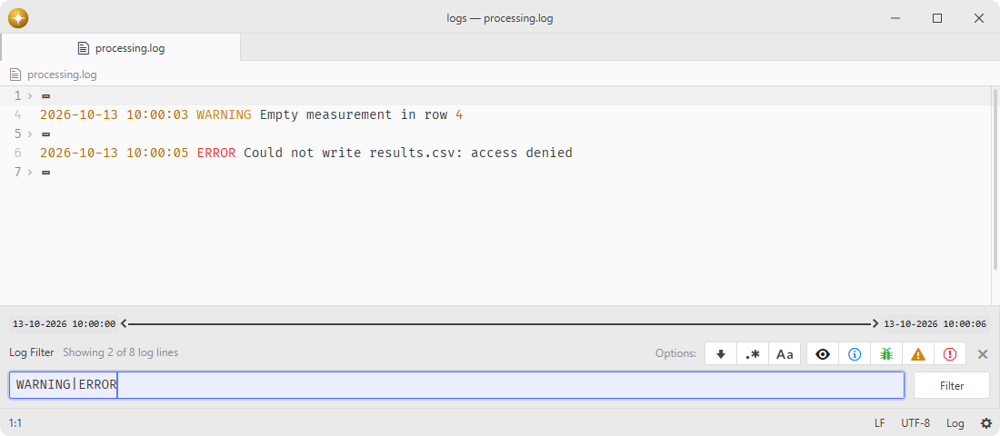

# log-filter

Filter log lines by text and severity level.

The panel folds away every line that does not match, so a large log can be narrowed down without editing or copying it.

## Features

- **Filter panel**: adds a bottom panel that hides every line the query does not match.
- **Text filtering**: matches the query literally, or as a regular expression when regex mode is on.
- **Case sensitivity**: toggles case sensitive matching of the text query.
- **Severity filtering**: hides verbose, info, debug, warning, or error lines of a log grammar.
- **Context lines**: keeps a configurable number of lines visible around every match.
- **Timestamps**: shows the first and the last timestamp of the buffer above the query.
- **Tail mode**: keeps the editor scrolled to the bottom when the file changes on disk.
- **Persistent state**: remembers the query, the toggles, and the hidden severities per file across sessions.



## Installation

To install `log-filter` search for it in the Install pane of the Lumine settings, or run the command `lumine --install lumine-code/log-filter`.

## Commands

Commands available in `lumine-workspace`:

- `log-filter:toggle`: toggle the filter panel,
- `log-filter:toggle-focus`: move focus between the filter input and the editor.

## Usage

Text filtering works in any buffer, so the panel can be opened anywhere with `log-filter:toggle`.

Large filters read immutable snapshots cooperatively and store consecutive hidden rows as intervals. Literal queries work on giant rows and skip the rest of a row after its first match. Regex mode tests each complete row in an isolated worker, with a 1 Mi UTF-16 input limit per row and a one-second execution deadline; it never tests a truncated prefix. A source edit or a newer query cancels obsolete work.

Queries are limited to 65,536 UTF-16 units and filters to 10,000 separate fold regions. Exceeding either limit reports the problem and clears that filter without showing a partial result. The panel displays progress while applying a large set of folds. Timestamp discovery reads bounded chunks and accepts complete timestamp tokens up to 256 units; it does not copy a whole log row.

The severity buttons need a grammar that marks log levels with the `keyword.other.log.log-*` scopes, as `language-log` does. Such grammars are listed in the "Grammar scopes" setting, which also decides where the panel opens on its own when "Open panel automatically" is enabled; the buttons are hidden for every other grammar.

Selecting None removes the panel, its folds and pending analysis. Restoring a grammar reopens a previously visible panel with its query and options, including when automatic opening is disabled.

## Customization

The style of the panel can be adjusted in the user's `styles.css` file, e.g. tint the timestamp separator:

```css
.log-filter-view {
  --log-item-color: #4a5568;
}
```

## Contributing

Got ideas to make this package better, found a bug, or want to help add new features? Just drop your thoughts on GitHub. Any feedback is welcome!
